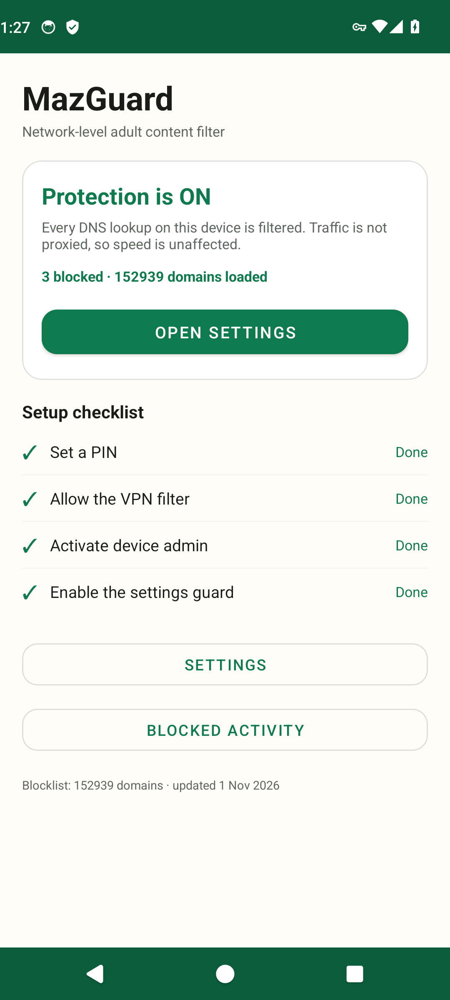

# MazGuard

A lightweight, network-level adult-content blocker for Android. It filters DNS,
not traffic — so it adds **no bandwidth cost and no measurable slowdown**, and it
cannot read, decrypt or log what you browse.



## Download

Grab `MazGuard-1.0.0.apk` from the [Releases](../../releases) tab and install it.
Android 8.0 (API 26) or newer.

## Why it is fast

Most "blockers" route every packet through a proxy. That is slow. MazGuard uses
`VpnService` with a single `/32` route: only DNS queries addressed to the app's
own resolver enter the tunnel. Everything else — video, downloads, games — keeps
using the physical network directly, at native speed.

- No proxying, no TLS interception, no traffic inspection.
- DNS answers are cached by the OS, so lookups cost nothing after the first hit.
- Idle memory is a few MB plus the blocklist set.
- The tunnel is completely idle when nothing is resolving.

## What it does

| Capability | Detail |
| --- | --- |
| Adult domain blocking | Bundled starter list (~300 well-known sites) plus a maintained public list (~80k domains) downloaded weekly. |
| Keyword filtering | Catches new/obscure domains whose labels look like adult content. |
| SafeSearch enforcement | DNS-level redirect to `forcesafesearch.google.com`, `strict.bing.com`, `safe.duckduckgo.com`, `restrict.youtube.com`. |
| Encrypted-DNS bypass blocking | Black-holes public DoH/DoT resolver addresses so apps cannot skip the filter. |
| Fail-closed | Queries are answered from an in-memory set; nothing is allowed while the list is still loading. |
| Block log | Local ring buffer of the last 200 blocked domains, plus a lifetime counter. |

## What it locks

Once activated, these actions require the PIN:

- Opening MazGuard's own **App info** page (force stop / uninstall / clear data).
- The **uninstall** confirmation dialog for MazGuard.
- **Device admin** deactivation for MazGuard.
- MazGuard's **Accessibility** toggle page.
- The system **VPN** screen (disconnecting the filter).
- The **Private DNS** screen (a filter bypass).

The rest of the Settings app remains fully usable. MazGuard never reads text from
other apps; the accessibility service only inspects the specific screens above and
only checks whether the app's own name appears on them.

The VPN is restarted after reboot, after an app update, when revoked, and by a
15-minute `JobScheduler` watchdog.

## Setup

1. Open the app and tap **Activate protection**.
2. Create a 4–12 digit PIN.
3. Allow the VPN (Android shows a one-time consent dialog).
4. Activate device admin.
5. Enable **MazGuard settings guard** under Settings → Accessibility.
6. Optional but recommended: Settings → Network → VPN → MazGuard → **Always-on VPN**
   and **Block connections without VPN**.

Turn off **Private DNS** (Settings → Network → Private DNS → Off). The app warns
if it is on.

## Honest limitations

Nothing installed on a phone you physically control is literally unbypassable. It
is hardened, not magical:

- Safe mode, a factory reset, or flashing the device defeats any app.
- ADB with the owner's authorisation can remove device admin and the VPN.
- An app with its own hardcoded encrypted resolver on an IP outside the bundled
  DoH list can still bypass DNS filtering. The list covers all major providers.
- Private DNS must be off. This is the one bypass MazGuard can only warn about,
  because Android does not let apps change that setting.
- Rooted devices can remove anything.

This is a parental-control / self-control tool. Use it on your own device, or on a
device whose owner has agreed to it.

## Lost PIN

The PIN is stored only as a PBKDF2 hash, so it cannot be read back. Recovery is
deliberate and requires physical/ADB access to the device:

```bash
adb shell dpm remove-active-admin com.mazdev.mazguard/com.mazdev.mazguard.service.AdminReceiver
adb shell pm clear com.mazdev.mazguard
```

Then disable the accessibility service in Settings and reinstall.

## Build

```bash
./gradlew assembleRelease
```

The APK lands in `app/build/outputs/apk/release/`. Release builds are signed with
`keystore.properties` if present, otherwise with the debug key.

Requirements: JDK 17, Android SDK 34, Gradle 8.7 (the wrapper handles this).

## Privacy

- No analytics, no accounts, no telemetry.
- No browsing data leaves the device.
- The only network request is the weekly blocklist download (plain HTTPS GET).

## License

MIT — see [LICENSE](LICENSE).
